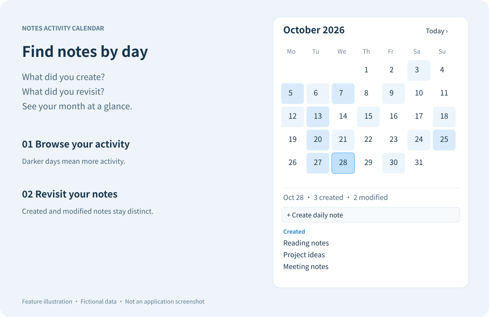
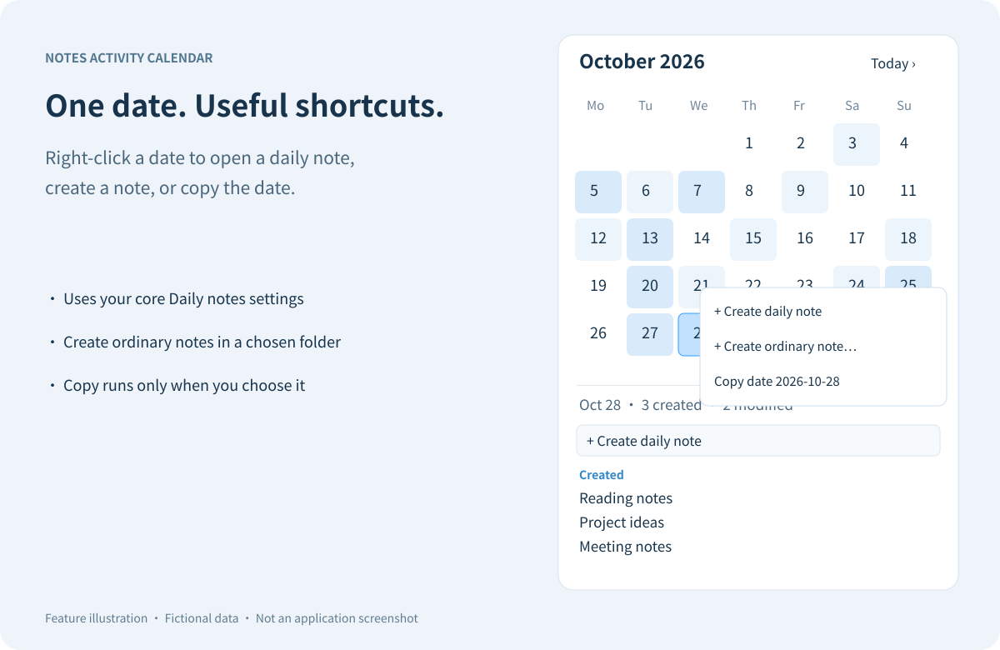

[English](https://github.com/Norman-lawyer/notes-activity-calendar/blob/main/README.md) | [简体中文](https://github.com/Norman-lawyer/notes-activity-calendar/blob/main/README.zh-CN.md)

# Notes Activity Calendar

**Find your notes by the day you created or edited them.**

[](https://github.com/Norman-lawyer/notes-activity-calendar/releases/latest)
[](https://community.obsidian.md/plugins/notes-activity-calendar)
[](LICENSE)

A sidebar calendar for Obsidian: scan a month of activity, select a date, and jump back to the notes you worked on. Optional lunar dates, solar terms, and daily-note shortcuts fit into the same view.

> These links switch the documentation language. The plugin interface is currently Chinese. Depending on the host, the other language may open on GitHub rather than inside the plugin page.



*Feature illustration using fictional notes, not an application screenshot. Labels are translated for this English guide; the shipped interface remains Chinese.*

## What can I do with it?

| Task | How it works |
| --- | --- |
| Find what you wrote on a day | Select a date to see separate lists of created and modified notes. Click a title to open it. |
| Review a busy month | Use the optional heatmap; darker dates have more note activity. Hover over a date for a short preview. |
| Jump to a different month | Use the arrows, choose a month from the month title, or return to today. |
| Focus on one project | Enable the folder/tag filter, or exclude folders from the display. |
| Keep a daily journal | Open or create that date's daily note using the core Daily notes folder, format, and template. |
| Check lunar dates | Optionally display Chinese lunar dates, festivals, and solar terms. |

## A date is also a shortcut

Right-click a date to open/create its daily note, create an ordinary note in a folder you choose, or copy the date. The optional loose-match setting recognizes a matching date prefix **only in the configured daily-note directory**.



*Illustration, not a screenshot. Copying writes only the selected date and happens only after you choose the copy action.*

## Install and open

1. In Obsidian, open **Settings → Community plugins** and enable community plugins.
2. Browse for **Notes Activity Calendar**, install it, and enable it.
3. Select the calendar icon in the ribbon. Use the plugin settings to choose your preferred week start, heatmap, lunar dates, filters, and previews.

For manual installation, download `main.js`, `manifest.json`, and `styles.css` from a published release. Place them in a `notes-activity-calendar` folder inside your vault's configured plugins directory, then enable the plugin. Do not install a source archive as if it were a release bundle.

**Requires Obsidian 1.14.5 or later.** The previous release was tested on macOS. The current changes have automated tests; desktop and mobile manual verification is still needed.

## How dates and history work

- Creation dates use an enabled filename date first, then configured frontmatter fields, then the file's creation time. Disable filename recognition if a past date in the title should not override the actual creation date.
- Modification history is collected while Obsidian is running and this plugin is enabled. The first start uses each file's current last-modified timestamp as a baseline; earlier edits cannot be reconstructed. After downtime, only the latest modification timestamp can be inferred.
- A note created and edited on its creation day appears once under created. Renames carry history to the new path. Deleted notes are hidden, but their recorded paths remain so a restored file can reappear.
- Activity history covers the whole vault. Filters and excluded folders affect the display, not collection.

## Privacy and boundaries

The plugin stores dates, file paths, and modification timestamps in its plugin data file. It does not store note contents in history or send data to a network service. Malformed saved settings/history are validated and discarded. Vault sync may also sync plugin data; simultaneous offline edits on multiple devices can cause data-file conflicts and have not been validated.

Vault-wide activity requires enumerating Markdown files. The copy-date action writes to the clipboard only on request and never reads it. These capabilities can remain visible in automated review; directory listing and passing checks are not a manual security review.

Core Daily notes settings have no public settings API. The compatibility access is runtime-checked, with defaults when unavailable. Invalid paths stop daily-note creation without taking down the calendar or silently writing elsewhere.

## About the badges

These are [Shields.io badges](https://shields.io/), not a mandatory Obsidian template. The release badge updates from published GitHub releases. The downloads badge links to the official Obsidian listing: the numeric badge could not be verified reliably in this environment, so this version links to the source rather than substituting GitHub asset-download counts or inventing a total. See [badge sources and maintenance](docs/BADGES.md). Hosts may cache badges or open links externally.

## Development

```sh
npm ci --ignore-scripts
npm run check
```

This runs strict TypeScript checks, zero-warning lint, a production build, and in-memory regression tests. Source: `src/*.ts`. The build uses pinned dependencies and emits `main.js`. Release assets are only `main.js`, `manifest.json`, and `styles.css`; license texts are embedded in the bundle. See [release and security checks](docs/RELEASING.md) before creating or publishing a release.

## License

[MIT](LICENSE). Includes [lunar-javascript](https://github.com/6tail/lunar-javascript), copyright © 2018 6tail, under its [MIT license](LUNAR-LICENSE).
